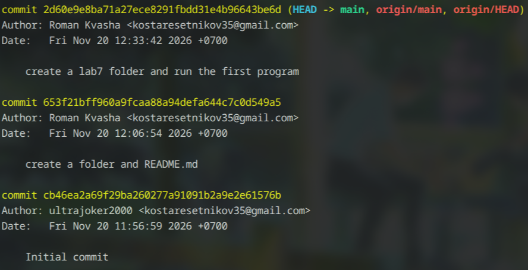
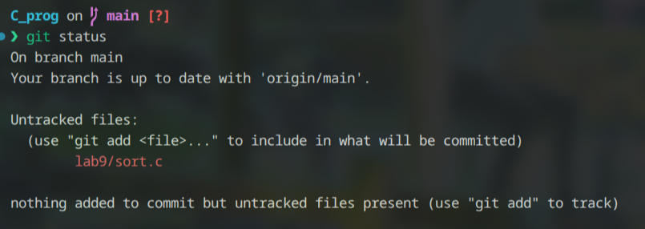
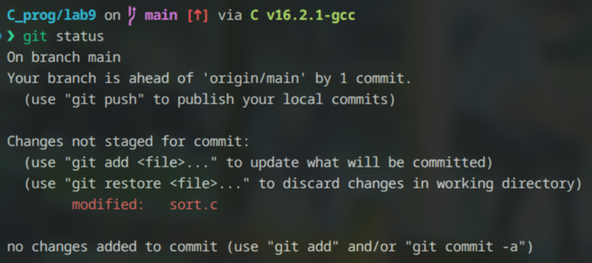
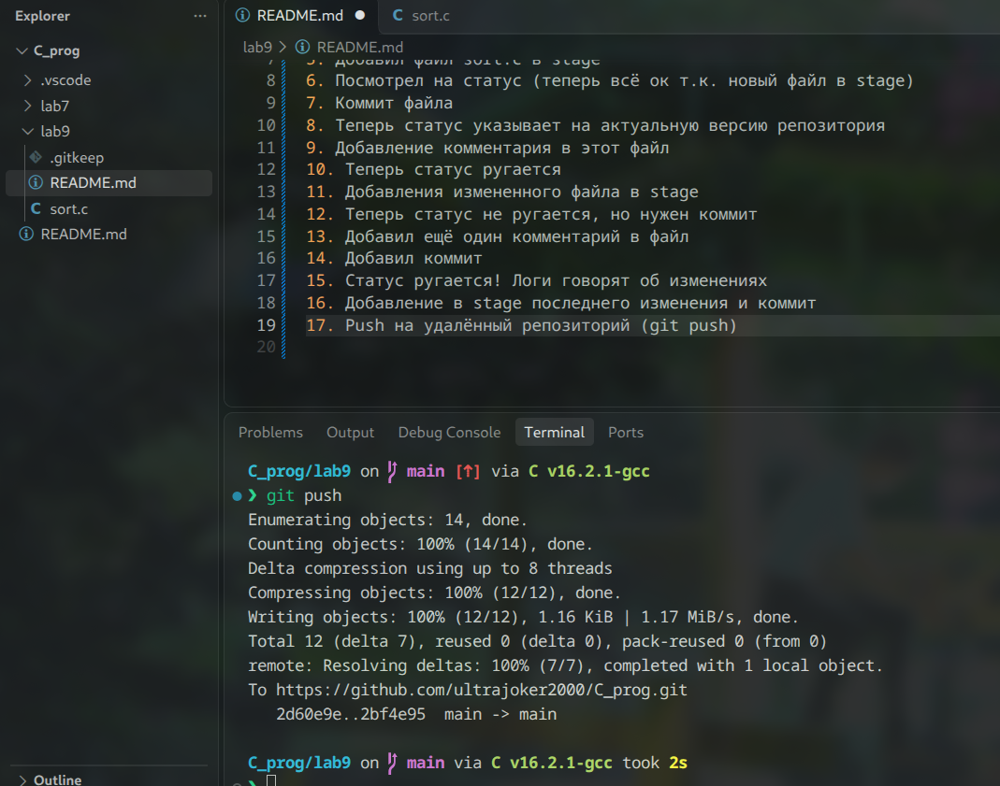
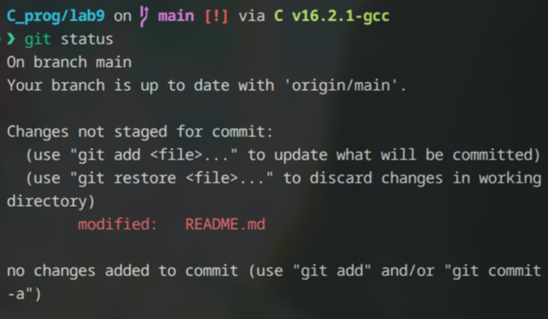
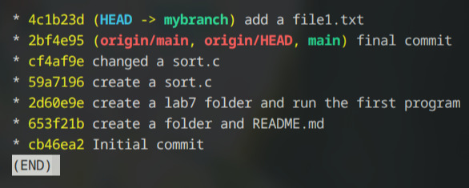
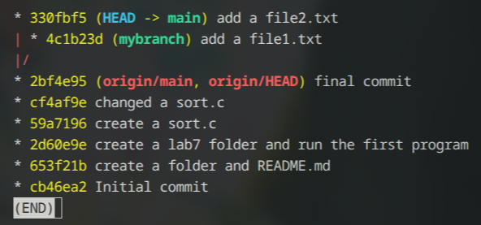
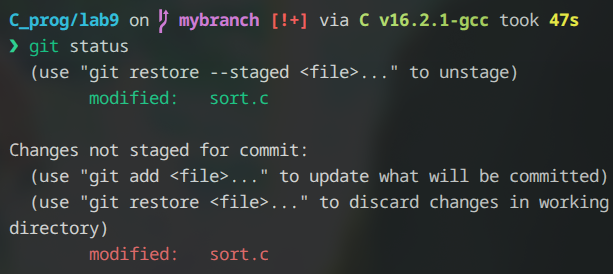
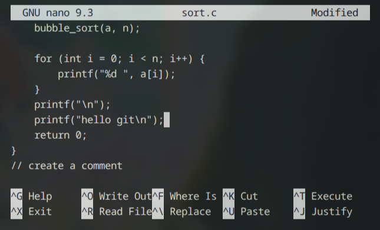
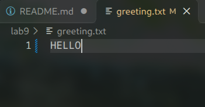

Выполнение на оценку 5

# Блок 1

1. Посмотрел status
2. Посмотрел git log
3. Создал файл sort.c и добавил туда функцию сортировки BubbleSort
4. Просмотрел git status
5. Добавил файл sort.c в stage
6. Посмотрел на статус (теперь всё ок т.к. новый файл в stage)
7. Коммит файла
8. Теперь статус указывает на актуальную версию репозитория
9. Добавление комментария в этот файл
10. Теперь статус ругается
11. Добавления измененного файла в stage
12. Теперь статус не ругается, но нужен коммит
13. Добавил ещё один комментарий в файл
14. Добавил коммит
15. Статус ругается! Логи говорят об изменениях
16. Добавление в stage последнего изменения и коммит
17. Push на удалённый репозиторий (git push)

# Ветки

1. Создал ветку mybranch через git checkout -b
2. Убедился что ветка создана (git branch)
3. Уже переключился (1 пункт)
4. Проверка status в обеих ветках дала один и тот же результат
5. Убедился, что нахожусь в ветке mybranch через git branch (* - указатель текущей ветки)
6. Создал файл file1.txt через терминал (touch)
7. Добавление файла в stage + commit
8. Граф действительно указывает на последний коммит
9. Переключение на ветку main
10. В ветке main граф указывает не на последний коммит. он указывает на "final commit"
11. Создание файла file2.txt + commit
12. Теперь всё выглядит корректно - в обеих ветках граф указывает на последний коммит
13. Переключение на ветку mybranch
14. Результат команды ls показал, что файл "file2.txt" отсутствует
15. Просмотр разницы между ветками. Результат работы программы показал, что разница - два коммита
16. Добавление текстового документа со скриншотами в ветку mybranch (он итак есть - README.md) + commit + push
17. Пуш ветки main + проверка в репозиторие GitHub

# Блок 2

1. Переключение на ветку mybranch
2. Перезапись sort.c через редактор nano
3. git diff показал изменения файла
4. git diff --staged действительно пустой
5. Добавление в staged файла sort.c
6. Теперь git diff тоже пустой
7. В git diff -staged перенеслось содержимое git diff до добавления файла в stage
8. Удаление числа из массива в функции main()
9. Теперь git diff снова заполнился изменениями в файле
10. В git diff --staged хранятся прошлые изменения файла, т.к. новые изменения мы не добавили в stage
11. Случайно объяснил выше
12. git status показывает два файла sort.c в выводе
13. Запуск git restore --staged sort.c
14. git status указывает только на один измененный sort.c файл
15. Индексация изменений + коммит
16. Проверка журнала. Сейчас журнал указывает на последний коммит (из предыдущего пункта)
17. Добавление вывода строки в главную функцию sort.c
18. Проверим содержимое sort.c через команду cat. В нём находится функция сортировки(BubbleSort), главная функция с массивом чисел, вызовом функции, выводом текста из предыдущего пункта и двух комментариев, созданных в первом блоке
19. git status указывает на измененный sort.c
20. git restore sort.c
21. После сброса изменений, в файле sort.c пропал вывод текста из пункта 17
22. Теперь git status говорит о том, что всё в порядке
23. Пуш ветки mybranch

# Ветки и ff-merge

1. Создание файла, индексирование и коммит с данным сообщением
2. Добавление в файл слова hello. Индексирование + коммит
3. Создание ветки с именем feature/uppercase
4. Переключение на эту ветку
5. git status говорит, что всё ок
6. Редактирование greeting.txt
7. Индексирование + коммит
8. Вывод git branch - зеленая ветка, в которой я нахожусь сейчас, и main, mybranch
9. Граф указывает на последний коммит
10. Переключение на главную ветку
11. Просмотр содержимого greetings.txt через cat. "No such file of directory"
12. Сравнение веток через diff указывает на все изменения в ветках
13. Объединение веток через git merge mybranch features/uppercase
14. Просмотр содержимого greeting.txt (HELLO%)
15. Удаление ветки feature/uppercase
16. Слияние mybranch в main
17. Граф указывет на мёрдж веток
18. Пуш изменения main

# Блок 3

1. Создание ветки branch1
2. Выполнить команду $ echo "This is a relevant fact" > file.txt
3. Коммит изменения
4. Свитч на главную ветку и выполнение команды $ echo "This is an indispensable truth!" > file.txt
5. Commit
6. Граф указывает на коммит создания файла в главной ветке
7. Слияние веток
8. Статус указывает на опоздания на 3 коммита
9. Для исправления конфликта весь текст был заменён на тот, который требует задание
10. Теперь граф указывает на коммит с исправлением конфликта
11. Push

# Merge-конфликты для сортировки MergeSort на Python

1. Создание mergesort.py в главной ветке и добавление в него содержимого из base.py
2. Commit
3. Создание новой ветки Mergesort-Impl
4. Содержимое файла mergesort.py меняем на код из righty.py
5. Commit
6. Переключаемся в главную ветку и меняем содержимое mergesort.py на код из lefty.py
7. Commit
8. Граф указывает на последние два коммита
9. git branch показывает ветки mybranch, branch1, Mergesort-Impl, main
10. Мёрж Mergesort-Impl в main
11. Push

## Скриншоты работы

